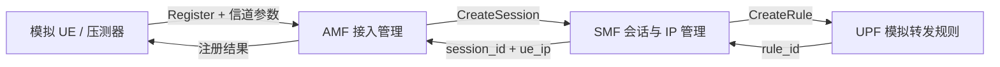

# LiteCore

LiteCore 是一个用 Go、Protobuf 和 gRPC 实现的轻量级 5G 核心网仿真与性能验证平台。项目以 AMF、SMF、UPF 三个核心网元为主体，支持模拟 UE 注册、信道感知接入、会话与 IP 管理、模拟转发规则、完整注销、多 UE 并发压测，以及 Docker/Kubernetes 部署。

> 本项目用于教学、核心流程验证和软件控制面性能实验，不是完整 3GPP 商用实现，不能直接连接真实手机、gNB 或 USRP，也没有实现 NAS、PFCP、GTP-U 等标准协议。

## 系统能力

- 首次注册时根据信号功率和 SINR 接受或拒绝 UE
- `UE → AMF → SMF → UPF` 完整注册链路
- 幂等注册、会话创建和规则创建
- `AMF → SMF → UPF` 完整资源释放
- 并发安全的 UE、会话、IP 池和转发规则状态
- 跨服务超时、错误传播和失败回滚
- stable、edge、degrading、mixed 四种信道场景
- 多 UE 并发压测，输出成功率、吞吐量和仅含成功请求的平均延迟、P50/P95/P99
- 注册瞬态失败自动重试最多2次，CSV记录实际重试次数
- benchmark结束后自动注销成功UE并回收IP
- gRPC健康服务、5秒上限的优雅退出、Docker/K8s TCP探针
- 单元测试和竞态检测

## 架构



详细设计见 [docs/ARCHITECTURE.md](docs/ARCHITECTURE.md)，队友交接说明见 [docs/HANDOFF.md](docs/HANDOFF.md)。

## 最快启动

环境要求：Go 1.25+、Docker Compose；重新生成 Protobuf 时还需要 `protoc`、`protoc-gen-go` 和 `protoc-gen-go-grpc`。

```bash
docker compose up -d --build
docker compose ps

# 注册一个稳定信道UE
docker compose --profile tools run --rm ue

# 查看网元日志
docker compose logs -f amf smf upf
```

停止服务：

```bash
docker compose down
```

系统没有数据库或Docker volume，停止后内存状态会清空。

## 本地开发

分别打开三个终端：

```bash
go run ./upf
go run ./smf
go run ./amf
```

第四个终端运行UE：

```bash
go run ./ue -action register -id UE-001 -scenario stable
go run ./ue -action get -id UE-001
go run ./ue -action register -id UE-EDGE -scenario edge
go run ./ue -action register -id UE-BAD -scenario degrading
go run ./ue -action deregister -id UE-001
```

## 并发实验

```bash
mkdir -p results
go run ./ue \
  -action benchmark \
  -count 500 \
  -concurrency 50 \
  -scenario mixed \
  -seed 42 \
  -run-id mixed-r1 \
  -output results/benchmark.csv
```

命令会输出请求总数、成功率、总请求吞吐量，以及成功注册的平均延迟、P50、P95、P99和最大延迟；随后批量注销成功UE并报告清理结果。`seed`固定后信道样本可复现，每次正式重复实验还应使用不同的`run-id`，避免命中旧UE的幂等路径。CSV包含`retry_count`。详细实验方案见 [docs/EXPERIMENTS.md](docs/EXPERIMENTS.md)。

本地SMF默认IP池为254；Docker/Kubernetes示例配置为2048。大于254 UE的本地实验必须设置更大的`IP_POOL_SIZE`。为保证重复实验彼此独立，确认自动清理没有失败，或在每轮之间重启整个服务栈。

## 测试

```bash
make test
make race
go vet ./amf/... ./smf/... ./upf/... ./ue/...
```

测试覆盖信道门控与模型替换、注册重试、成功延迟统计、benchmark自动清理、注册/注销并发状态、会话代次与IP回收、UPF规则所有权、查询语义、后台任务关闭及模拟包计数。

## Kubernetes

先构建镜像：

```bash
docker compose build
kubectl apply -f k8s/
kubectl get pods,svc
kubectl port-forward service/amf 50051:50051
```

如果使用 kind/minikube，需要把本地镜像加载进集群。AMF、SMF、UPF的状态都保存在各自进程内，因此三个清单均保持单副本；在没有共享状态和一致性设计前，不能通过简单扩副本宣称实现了有状态服务高可用。Kubernetes故障演示只验证进程能被重新拉起，状态会丢失。

## 目录

```text
proto/   gRPC接口定义和生成代码
amf/     接入控制、UE状态、SMF调用
smf/     会话、IP池、UPF调用
upf/     转发规则和模拟包统计
ue/      单UE客户端、信道模型、并发压测器
k8s/     Deployment、Service和健康探针
docs/    架构、实验与交接文档
```

## 项目边界与后续工作

当前“UPF转发”是名义10包/秒的软件计数仿真，不是真实网络包转发；DNN固定为`internet`。信道模型接口只负责产生信号强度和SINR，-110 dBm和0 dB门限归AMF。注册后没有持续信道监测，因此信道变差不会踢UE下线，详见[ADR-0002](docs/ADR-0002.md)。可选扩展包括：Redis共享状态、OpenTelemetry链路追踪、Prometheus监控、TUN/TAP或UDP用户面。任何扩展都不应把本项目描述为完整3GPP核心网。
